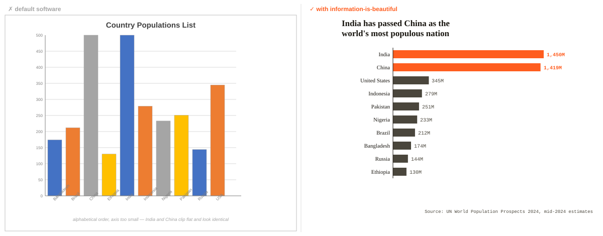
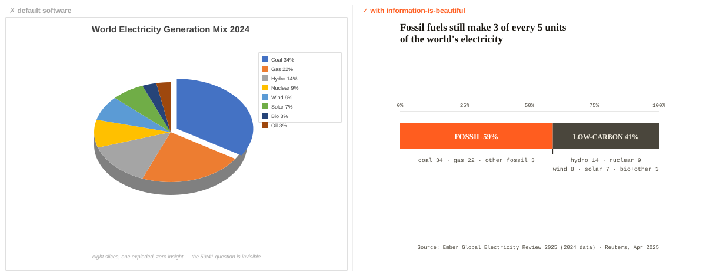

<p align="center">
  
</p>

<h1 align="center">information-is-beautiful <span style="font-weight:400">(IIB)</span></h1>

<p align="center">
  <em>Beautiful enough to be looked at. Honest enough to be trusted.</em>
</p>

<p align="center">
  <strong>Five checkable laws. One decision table. A 25-point audit.</strong><br>
  <strong>Your agent ships charts people actually trust — not default-software slop.</strong>
</p>

<p align="center">
  <a href="https://github.com/karefined-eng/information-is-beautiful-skill/stargazers"></a>
  <a href="https://github.com/karefined-eng/information-is-beautiful-skill/releases"></a>
  
  <a href="https://information-is-beautiful-skill.vercel.app"></a>
  
</p>

---

An [Agent Skill](https://agentskills.io) that teaches AI coding agents the craft of
**honest, editorial-quality information design** — charts, graphs, infographics,
KPI dashboards, and data-driven layouts that follow one discipline: *form follows
data*. It is an original synthesis of David McCandless' publicly stated design
philosophy and the wider craft lineage (Tufte, Few, Cairo, WCAG). It contains
**nothing from the book** — every principle's lineage is cited in
[`skills/information-is-beautiful/references/sources.md`](skills/information-is-beautiful/references/sources.md).

## Install

**One command, any Agent-Skills-compatible agent:**

```bash
npx skills add karefined-eng/information-is-beautiful-skill
```

**Or copy the folder** wherever your agent loads skills:

```bash
# Claude Code
cp -r skills/information-is-beautiful ~/.claude/skills/

# ZCode
cp -r skills/information-is-beautiful ~/.agents/skills/
ln -s ~/.agents/skills/information-is-beautiful ~/.zcode/skills/
```

<details>
<summary><strong>Want the short command?</strong> Create a local <code>/iib</code> alias</summary>

Keep it out of the published skill — a second listed skill would split install counts.
A five-line local wrapper is all it takes:

```bash
mkdir -p ~/.agents/skills/iib && cat > ~/.agents/skills/iib/SKILL.md <<'EOF'
---
name: iib
description: Fast alias for information-is-beautiful — behave exactly like that skill, with the typed arguments as the design brief.
license: MIT
---
Load and fully follow ~/.agents/skills/information-is-beautiful/SKILL.md and its
references/ folder; treat the user's typed arguments as its design brief.
EOF
ln -s ~/.agents/skills/iib ~/.zcode/skills/iib   # ZCode (optional)
```
</details>

## What your agent gets

**Three data shapes, three different forms.** A ranking becomes sorted bars, a composition becomes
one aggregated bar, a time series becomes a line — the
[chart-matcher](skills/information-is-beautiful/references/chart-matcher.md) picks the geometry,
and the five laws keep it honest. Every number in these demos is real and cited.

**1 · Ranking — the comparison hides until you sort.** Sloppy software lists countries alphabetically
with an axis too small for the giants, so India and China clip flat and look identical. The skill
sorts by magnitude and accents the only comparison that matters:

<p align="center">
  
</p>

**2 · Composition — a pie is the wrong answer to a simple question.** Eight slices, one exploded,
nothing said. The matcher aggregates to the comparison the reader actually cares about:

<p align="center">
  
</p>

**3 · Time — and yes, we can localize.** Ghana's real CPI collapse, from the 54% peak to holding
near 5% (Ghana Statistical Service):

<p align="center">
  
</p>

And when the honest form is *correct but forgettable*, the
[creative-moves](skills/information-is-beautiful/references/creative-moves.md) reference supplies
the ingenuity layer — eight generative patterns (one scale for incommensurables, time as terrain,
evidence grids, meta-visuals) distilled from the formats that made information design iconic.
Cited as concepts with full lineage, never redrawn.

1. **Form follows data** — geometry matches the comparison, chosen via a
   [decision-table matcher](skills/information-is-beautiful/references/chart-matcher.md)
   (quantity / time / category / geography / network / hierarchy), never "pick a chart type and force data in".
2. **Honest scales** — axes start at zero, area encodes by area, units named everywhere.
3. **Colour is a data channel** — hue = category, intensity = magnitude, one accent hue per visual, from a
   [house palette](skills/information-is-beautiful/references/palettes.md) with exact hexes.
4. **Ink must be earned** — chartjunk deleted aggressively: no 3D, no dual axes, no legend wallpaper.
5. **Annotation is narration** — the title states the *insight* ("Bailouts dwarf malaria funding 40:1"), not the topic.

Plus a [25-point quality checklist](skills/information-is-beautiful/references/quality-checklist.md)
the agent must pass before delivery, a render-and-re-audit step, and a worked
example with numeric defaults. Pure markdown — no binaries, no network, no scripts.

## Use

```
/information-is-beautiful redesign this bar chart honestly
/information-is-beautiful pick the right form for: country, gdp_2024, population
/information-is-beautiful audit this SVG against the checklist
```

Or just ask for a chart, dashboard, or infographic — the description match triggers it automatically.

## See it live

The [tribute site](https://information-is-beautiful-skill.vercel.app) showcases the
skill, serves it for
[direct download](https://information-is-beautiful-skill.vercel.app/skills/information-is-beautiful/SKILL.md),
and tells the [origin story](docs/origin.md) — including the verified lineage of
every principle.

## Provenance

Fan-made homage, MIT-licensed for remixing. Not affiliated with or endorsed by
David McCandless or HarperCollins. No text, figures, or datasets from the book are
reproduced; cite the authentic sources, never this skill. Keep
`references/sources.md` intact so provenance survives the fork.
