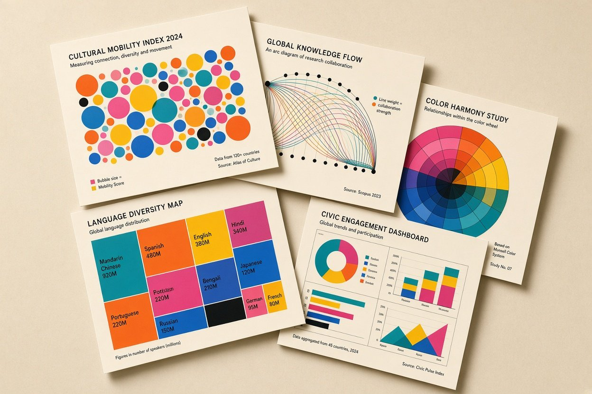
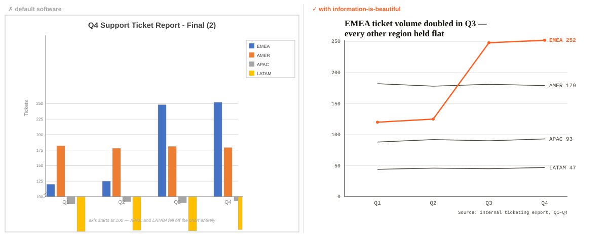

<p align="center">
  
</p>

<h1 align="center">information-is-beautiful <span style="font-weight:400">(IIB)</span></h1>

<p align="center">
  <em>Beautiful enough to be looked at. Honest enough to be trusted.</em>
</p>

<p align="center">
  <strong>Five checkable laws. One decision table. A 25-point audit.</strong><br>
  <strong>Your agent ships charts people actually trust — not default-software slop.</strong>
</p>

<p align="center">
  <a href="https://github.com/karefined-eng/information-is-beautiful-skill/stargazers"></a>
  
  <a href="https://information-is-beautiful-skill.vercel.app"></a>
  
</p>

---

An [Agent Skill](https://agentskills.io) that teaches AI coding agents the craft of
**honest, editorial-quality information design** — charts, graphs, infographics,
KPI dashboards, and data-driven layouts that follow one discipline: *form follows
data*. It is an original synthesis of David McCandless' publicly stated design
philosophy and the wider craft lineage (Tufte, Few, Cairo, WCAG). It contains
**nothing from the book** — every principle's lineage is cited in
[`skills/information-is-beautiful/references/sources.md`](skills/information-is-beautiful/references/sources.md).

## Install

**One command, any Agent-Skills-compatible agent:**

```bash
npx skills add karefined-eng/information-is-beautiful-skill
```

**Or copy the folder** wherever your agent loads skills:

```bash
# Claude Code
cp -r skills/information-is-beautiful ~/.claude/skills/

# ZCode
cp -r skills/information-is-beautiful ~/.agents/skills/
ln -s ~/.agents/skills/information-is-beautiful ~/.zcode/skills/
```

## What your agent gets

<p align="center">
  
</p>

<p align="center"><sub>Same data, two agents. Left is what you get by default (note where APAC and LATAM went — the axis starts at 100). Right follows the five laws.</sub></p>

Five checkable laws it must satisfy before shipping any visual:

1. **Form follows data** — geometry matches the comparison, chosen via a
   [decision-table matcher](skills/information-is-beautiful/references/chart-matcher.md)
   (quantity / time / category / geography / network / hierarchy), never "pick a chart type and force data in".
2. **Honest scales** — axes start at zero, area encodes by area, units named everywhere.
3. **Colour is a data channel** — hue = category, intensity = magnitude, one accent hue per visual, from a
   [house palette](skills/information-is-beautiful/references/palettes.md) with exact hexes.
4. **Ink must be earned** — chartjunk deleted aggressively: no 3D, no dual axes, no legend wallpaper.
5. **Annotation is narration** — the title states the *insight* ("Bailouts dwarf malaria funding 40:1"), not the topic.

Plus a [25-point quality checklist](skills/information-is-beautiful/references/quality-checklist.md)
the agent must pass before delivery, a render-and-re-audit step, and a worked
example with numeric defaults. Pure markdown — no binaries, no network, no scripts.

## Use

```
/information-is-beautiful redesign this bar chart honestly
/information-is-beautiful pick the right form for: country, gdp_2024, population
/information-is-beautiful audit this SVG against the checklist
```

Or just ask for a chart, dashboard, or infographic — the description match triggers it automatically.

## See it live

The [tribute site](https://information-is-beautiful-skill.vercel.app) showcases the
skill, serves it for
[direct download](https://information-is-beautiful-skill.vercel.app/skills/information-is-beautiful/SKILL.md),
and tells the [origin story](docs/origin.md) — including the verified lineage of
every principle.

## Provenance

Fan-made homage, MIT-licensed for remixing. Not affiliated with or endorsed by
David McCandless or HarperCollins. No text, figures, or datasets from the book are
reproduced; cite the authentic sources, never this skill. Keep
`references/sources.md` intact so provenance survives the fork.
